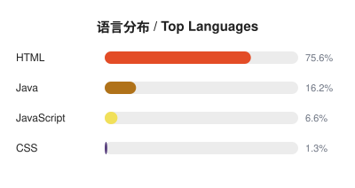

# 👋 Hi, I'm Annabergite

**前大厂工程师 · Java 后端 → Agent 转型中** | **Ex-Big-Tech Engineer · Java Backend → Agent**

📍 杭州 · 欢迎全国 / 全球岗位推荐 | 📍 Hangzhou · Open to opportunities across China & worldwide

---

<table>
<tr>
<td width="50%" valign="top">

### 👨‍💻 关于我 / About Me

- 前大厂工程师，Java 后端出身，正在转型 **Java + Agent** | Ex-Big-Tech engineer with a Java backend background, transitioning into **Java + Agent**
- ❤️ 热爱生活：吹水、跑步、骑行、健身，都可以加我 | Love life — chatting, running, cycling, fitness

### 🧭 感兴趣 / Interests

- 🤖 Agent Harness
- 🐹 Go
- 🏗️ System Design（底层 / Low-level）
- 🐧 Linux（底层 / Low-level）

### 🗓️ 年度主题 / Yearly Themes

| 年份 Year | 主题 Theme |
| --- | --- |
| 2023 | 各项交付 · Delivery |
| 2024 | 源码阅读 · Source Code Reading |
| 2025 | 软实力提升 · Soft Skills |
| 2026 | Agent 学习 · Agent Learning |

</td>
<td width="50%" valign="top">

### 📮 联系 / Contact

📧 [ziboqizhong@outlook.com](mailto:ziboqizhong@outlook.com) · 💬 WeChat：备注 `git`

  

### 📊 语言分布 / Languages

  

</td>
</tr>
</table>
